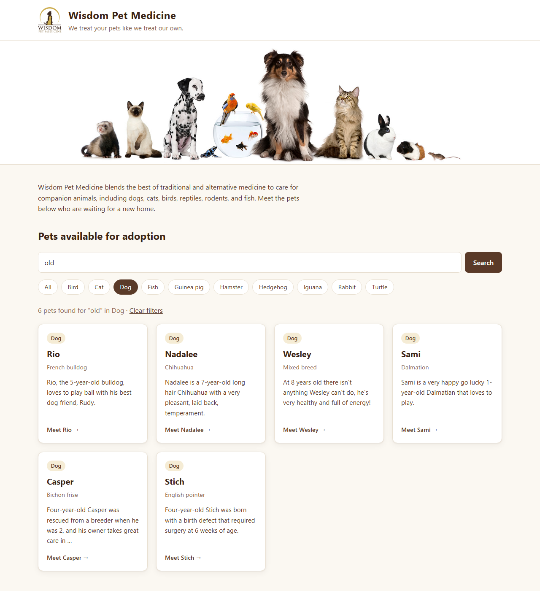
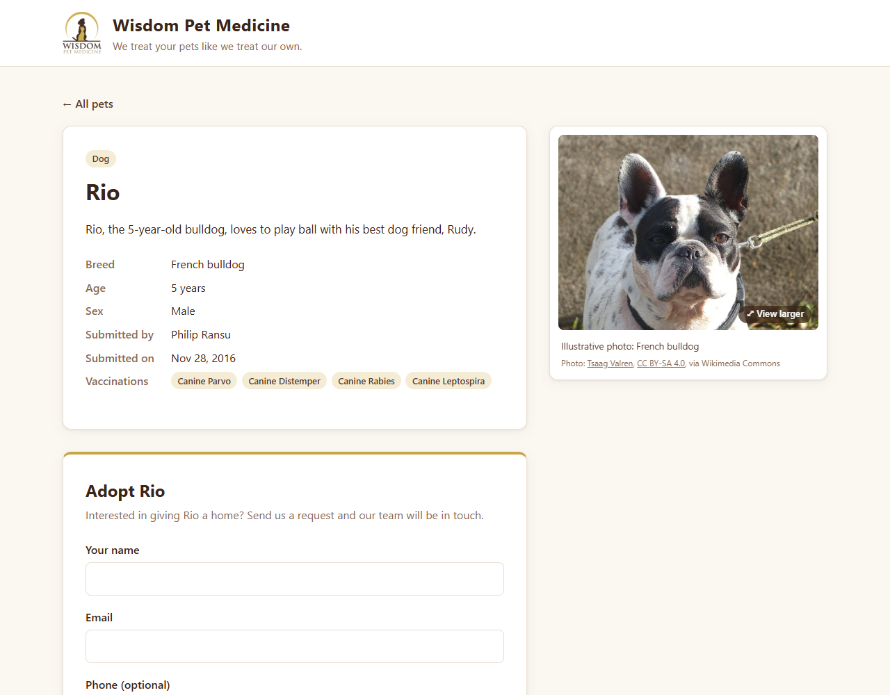
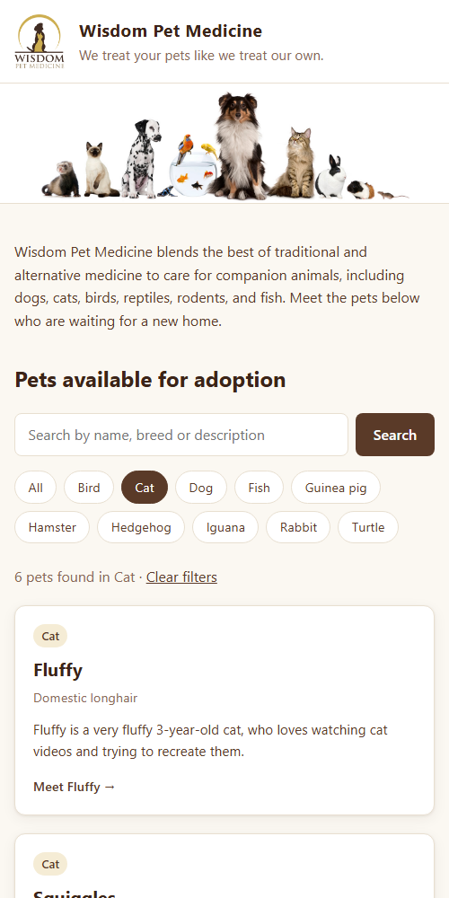

# Wisdom Pets — Pet Adoption Site

[](https://github.com/Kishore-1011/WisdomPets/actions/workflows/tests.yml)


A Django web app for a fictional veterinary clinic that lists pets available for adoption. Visitors can search and filter pets, view their details and vaccinations, and send an adoption request. Clinic staff review and track requests in the Django admin.

**🔗 Live demo: [kishore1011.pythonanywhere.com](https://kishore1011.pythonanywhere.com)**
(runs in demo mode: the adoption form works, but nothing you enter is stored or sent)



## Features

- **Pet listings** in a responsive card grid, with breed, species and a short description
- **Search** across name, breed and description, combined with a **species filter**; filters live in the URL, so results can be shared or bookmarked
- **Pet detail pages** with age, sex, submitter and vaccination records, plus a **photo of each pet** that opens in a larger viewer
- **Adoption request form** with validation (email, optional phone) and CSRF protection; a confirmation message is shown after submitting
- **Staff admin** to manage pets and adoption requests, with status tracking (New → Contacted → Approved / Declined), filters and search
- **Demo mode** for public deployments: a site-wide notice, and the adoption form validates but never stores visitors' details
- **CSV data import** through a custom management command
- **Automated tests** (28) running on GitHub Actions for Python 3.12 and 3.13

| Pet details and adoption form | Mobile view |
|---|---|
|  |  |

## Tech stack

- **Backend:** Python, Django 5.2 LTS
- **Database:** SQLite
- **Frontend:** Django templates, hand-written responsive CSS (no framework)
- **Testing / CI:** Django test framework, GitHub Actions

## Getting started

**Requirements:** Python 3.12 or newer.

```bash
git clone https://github.com/Kishore-1011/WisdomPets.git
cd WisdomPets

python -m venv .venv
source .venv/bin/activate        # Windows: .venv\Scripts\activate
pip install -r requirements.txt

cp .env.example .env             # local settings (debug on, dev secret key)
python manage.py migrate
python manage.py load_pet_data   # imports 24 pets from pet_data.csv
python manage.py createsuperuser # login for /admin
python manage.py runserver
```

Then open http://127.0.0.1:8000. Adoption requests can be managed at http://127.0.0.1:8000/admin.

### Configuration

Settings are read from environment variables (or a `.env` file):

| Variable | Description | Default |
|---|---|---|
| `DJANGO_DEBUG` | Turns on debug mode | `False` |
| `DJANGO_SECRET_KEY` | Secret key; required when debug is off | dev-only key when debug is on |
| `DJANGO_ALLOWED_HOSTS` | Comma-separated host names | `localhost,127.0.0.1` |
| `DJANGO_CSRF_TRUSTED_ORIGINS` | Full origins allowed to submit forms over HTTPS | empty |
| `DJANGO_DEMO_MODE` | Shows a "demo site" banner and stops adoption requests from being stored | `False` |

## Deployment

The live demo runs on [PythonAnywhere](https://www.pythonanywhere.com) with `DJANGO_DEBUG=False`, `DJANGO_DEMO_MODE=True`, static files served by WhiteNoise, and HTTPS enforced. Because it's a public demo of a fictional clinic, it never stores the names, emails or phone numbers people type into the form. Run it locally with demo mode off to see requests arrive in the admin.

To update the live site after pushing changes:

```bash
cd ~/WisdomPets && source .venv/bin/activate
git pull && pip install -r requirements.txt
python manage.py migrate && python manage.py collectstatic --noinput
```

Then reload the web app from the PythonAnywhere **Web** tab.

## Running tests

```bash
python manage.py test
```

The suite covers models, search and filtering, pet pages, the adoption form (validation and CSRF), and the CSV import command.

## Project structure

```
WisdomPets/
├── adoptions/                  # Main app
│   ├── management/commands/    # load_pet_data CSV import
│   ├── migrations/
│   ├── static/                 # CSS, logo, header image
│   ├── templates/              # base, home, pet_detail
│   ├── admin.py                # Pet and AdoptionRequest admin
│   ├── forms.py                # Adoption request form
│   ├── models.py               # Pet, Vaccine, AdoptionRequest
│   ├── tests.py
│   └── views.py                # Home (search/filter) and pet detail
├── wisdompets/                 # Project settings and URLs
├── pet_data.csv                # Sample pet data
└── requirements.txt
```

## Background

This project started from the LinkedIn Learning *Learning Django* course, which provided the Wisdom Pet Medicine sample data and images. I have since extended it with:

- Upgrade to Django 5.2 LTS and environment-based settings
- A custom responsive design replacing the original external theme
- Search and species filtering
- The adoption request workflow (model, form, admin status tracking)
- A full test suite and continuous integration
- Bug fixes in the CSV import (character encoding, file handling)

Wisdom Pet Medicine is a fictional brand created by Lynda.com (LinkedIn Learning) for training purposes.

## Photo credits

The pet photos are illustrative images from [Wikimedia Commons](https://commons.wikimedia.org), used under their free licences (public domain, CC0, CC BY and CC BY-SA). Each pet page credits the photographer and licence under the photo, and the full list of authors, licences and source pages is in [`adoptions/pet_photos.py`](adoptions/pet_photos.py). Images were resized and compressed for the web; no other changes were made.
